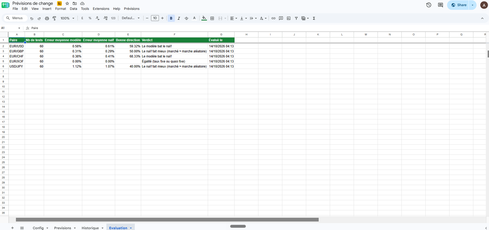
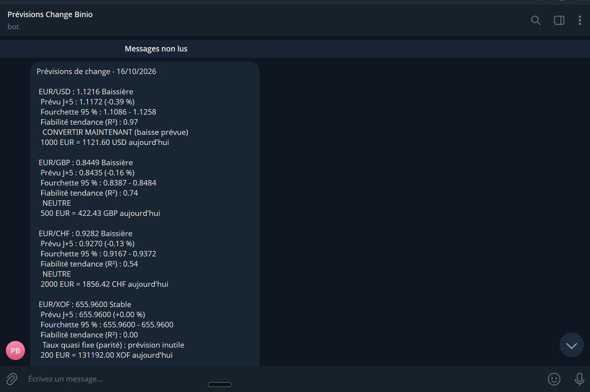

# 💱 Prévisions de change automatisées

> Un assistant Google Sheets × Apps Script qui collecte chaque jour les taux de change officiels, prévoit leur évolution à 5 jours, **mesure honnêtement sa propre fiabilité** et envoie sa recommandation sur Telegram.


---

## 🎯 Le problème

Chaque conversion de devise dépend d'un taux qui bouge : sur 1 000 €, une variation de 1 % représente environ 11 $. Pour une famille qui envoie de l'argent à l'étranger, une PME qui paie ses fournisseurs ou un trésorier, la question est toujours la même : **convertir aujourd'hui, ou attendre ?**

Ce projet apporte un éclairage chiffré à cette décision, de façon entièrement automatique.

## ⚙️ Fonctionnement

```
Google Sheets (Config)  →  API Frankfurter  →  Apps Script (nettoyage + modèle)  →  Google Sheets (résultats)  →  Telegram
   paires de devises        ~6 mois de taux       prévision J+5, backtest              3 onglets                    rapport 17 h
```

1. L'utilisateur liste ses paires de devises dans l'onglet **Config** (montant et taux objectif facultatifs).
2. Le script télécharge l'historique depuis l'[API Frankfurter](https://frankfurter.dev/) (taux de banques centrales et sources officielles, gratuite et sans clé), en **un seul appel par devise source**.
3. Les données sont **nettoyées** : les week-ends, où les marchés sont fermés et le taux simplement recopié, sont exclus.
4. Le modèle calcule la prévision, la fourchette d'incertitude et un conseil.
5. Les résultats sont écrits dans les onglets **Previsions**, **Historique** et **Evaluation**.
6. Un **déclencheur horaire** envoie le rapport sur Telegram chaque jour ouvré vers 17 h, même ordinateur éteint.

## 🗃️ Données

### Sources
| Source | Rôle | Accès |
|---|---|---|
| [API Frankfurter](https://frankfurter.dev/) | Source utilisée par le script : taux de change quotidiens agrégés à partir de banques centrales et de sources officielles | Gratuite, sans clé, formats JSON et CSV |
| [Banque centrale européenne](https://www.ecb.europa.eu/stats/policy_and_exchange_rates/euro_reference_exchange_rates/html/index.en.html) | Source officielle de référence pour les taux de l'euro (historique depuis 1999) | Téléchargement CSV libre |

Le franc CFA (XOF) n'est pas publié par la BCE, car il a une parité fixe avec l'euro (1 € = 655,957 FCFA) : il provient de Frankfurter.

### Fichiers du dossier [`data/`](data/)
| Fichier | Étape | Contenu |
|---|---|---|
| `config_exemple.csv` | Entrée | Les 5 paires suivies, montants et taux objectif |
| `raw/` | Brut | Taux tels que renvoyés par l'API, week-ends inclus |
| `processed/historique.csv` | Nettoyé | Jours ouvrés uniquement, une colonne par paire (onglet Historique) |

> ⏳ **Les fichiers de `data/` sont un instantané historique (20/04/2026 → 17/10/2026)**, figé à la date de l'analyse. Ils servent à **reproduire et vérifier** les résultats présentés ici. Le script, lui, n'en a pas besoin : il interroge l'API **en direct** à chaque exécution et travaille toujours sur des données à jour.

Pour récupérer soi-même les données brutes, il suffit d'ouvrir cette adresse dans un navigateur (le fichier CSV s'ouvre dans Excel) :
```
https://api.frankfurter.dev/v2/rates.csv?from=2026-04-20&base=EUR&quotes=USD,GBP,CHF,XOF
```
Ou, directement dans Google Sheets : `=IMPORTDATA("https://api.frankfurter.dev/v2/rates.csv?from=2026-04-20&base=EUR&quotes=USD,GBP,CHF,XOF")`

## 🧠 Le modèle

| Outil | Rôle |
|---|---|
| **Régression linéaire** (moindres carrés, 30 derniers jours) | Mesure la tendance ; le **R²** indique sa fiabilité |
| **Moyennes mobiles** MM7 / MM30 | Qualifient la tendance : haussière, baissière ou stable |
| **Volatilité** (écart-type des rendements logarithmiques) | Mesure l'amplitude normale des mouvements |
| **Fourchette à 95 %** : 1,96 × σ × √5 | L'incertitude grandit avec la racine du temps |

**Prévision retenue (« prudente »)** : `taux actuel + 50 % × pente × 5 jours`

**Règle de décision** : hausse prévue > 0,3 % → *attendre* · baisse > 0,3 % → *convertir* · sinon, ou si R² < 0,3 → *neutre* · parité fixe détectée (ex. EUR/XOF) → *signalée*.

## 📊 Évaluation : le backtest

Un modèle ne vaut que s'il bat une référence. Pour chaque paire, **60 prévisions passées** sont rejouées en n'utilisant que les données connues à chaque date, puis comparées au **modèle naïf** (« le taux ne bougera pas »).

Erreur moyenne à 5 jours ouvrés (en % du taux), mesurée en octobre 2026 :

| Paire | Modèle initial (100 % tendance) | Modèle prudent (50 %) | Modèle naïf |
|---|---|---|---|
| EUR/USD | 0,91 % | **0,58 %** | 0,61 % |
| EUR/GBP | 0,47 % | 0,31 % | **0,29 %** |
| EUR/CHF | 0,48 % | **0,38 %** | 0,41 % |
| USD/JPY | 1,49 % | 1,12 % | **1,07 %** |

**Ce que montrent ces résultats**
- La version initiale faisait **moins bien que le modèle naïf** sur toutes les paires (40,7 % de bonne direction sur EUR/USD, moins qu'un pile ou face).
- Ne suivre la tendance qu'à moitié réduit l'erreur partout, et le modèle prudent **bat le naïf sur EUR/USD et EUR/CHF**.
- Les écarts restent faibles et 60 tests ne constituent pas une preuve statistique : sur un horizon court, les taux de change se comportent presque comme une **marche aléatoire**, ce qui est cohérent avec l'hypothèse d'efficience des marchés.

## 📸 Aperçu

<!-- Ajouter les captures dans docs/screenshots/ puis décommenter les lignes ci-dessous -->
<!--  -->
<!--  -->
<!--  -->

Extrait d'un rapport reçu sur Telegram :

```
Prévisions de change - 14/10/2026

• EUR/USD : 1.1199 Baissière
  Prévu J+5 : 1.1155 (-0.40 %)
  Fourchette 95 % : 1.1069 - 1.1240
  Fiabilité tendance (R²) : 0.97
  CONVERTIR MAINTENANT (baisse prévue)
  1000 EUR = 1119.90 USD aujourd'hui
```

## 🗂️ Structure du code

Le code est découpé en modules, un par responsabilité :

| Fichier | Rôle |
|---|---|
| [`src/1_Config.gs`](src/1_Config.gs) | Tous les paramètres (horizon, fenêtres, seuils) |
| [`src/2_Api.gs`](src/2_Api.gs) | Appel de l'API, tri et nettoyage des données |
| [`src/3_Modele.gs`](src/3_Modele.gs) | Régression, moyennes mobiles, volatilité, prévision et conseil |
| [`src/4_Feuilles.gs`](src/4_Feuilles.gs) | Lecture de la configuration et écriture des résultats |
| [`src/5_Evaluation.gs`](src/5_Evaluation.gs) | Backtest face au modèle naïf |
| [`src/6_Telegram.gs`](src/6_Telegram.gs) | Rédaction et envoi du rapport (un ou plusieurs destinataires) |
| [`src/7_Menu.gs`](src/7_Menu.gs) | Menu personnalisé et déclencheur quotidien |
| [`data/`](data/) | Configuration d'exemple, données brutes et données nettoyées |

## 🚀 Installation

1. Créer un Google Sheet avec un onglet **`Config`** et ces en-têtes en ligne 1 :

   | Devise source | Devise cible | Montant à convertir | Taux objectif | Actif |
   |---|---|---|---|---|
   | EUR | USD | 1000 | 1,15 | ☑ |

2. **Extensions → Apps Script**, puis créer les 7 fichiers du dossier `src/` (même nom, même contenu).
3. Dans **Paramètres du projet**, régler le fuseau horaire sur Paris.
4. Créer un bot avec [@BotFather](https://t.me/BotFather), puis ajouter dans **Propriétés du script** :
   - `TELEGRAM_TOKEN` : le token du bot
   - `TELEGRAM_CHAT_ID` : un ou plusieurs identifiants séparés par des virgules (chat privé, `@canal`, groupe)
5. Recharger le Sheet et utiliser le menu **Prévisions** :
   - *Calculer les prévisions*
   - *Calculer + envoyer sur Telegram*
   - *Évaluer la précision du modèle*
   - *Activer l'envoi automatique*

> 🔒 Aucun secret n'est stocké dans le code : le token et les identifiants restent dans les Propriétés du script.

## 🧭 Limites et pistes

- Backtest sur une période courte : à étendre sur plusieurs années.
- Risque de surapprentissage si l'on teste trop de variantes sur les mêmes données.
- Prochaines étapes : devises plus volatiles (GHS, NGN), modèles de machine learning comparés au naïf, découpage du rapport au-delà de 15 paires (limite de 4 096 caractères de Telegram).

> ⚠️ Projet pédagogique : les prévisions ne constituent pas un conseil financier.

---

👤 **Aubain VIGLO** · Data & IA appliquées à la finance · [Profil GitHub](https://github.com/Aubain01)
